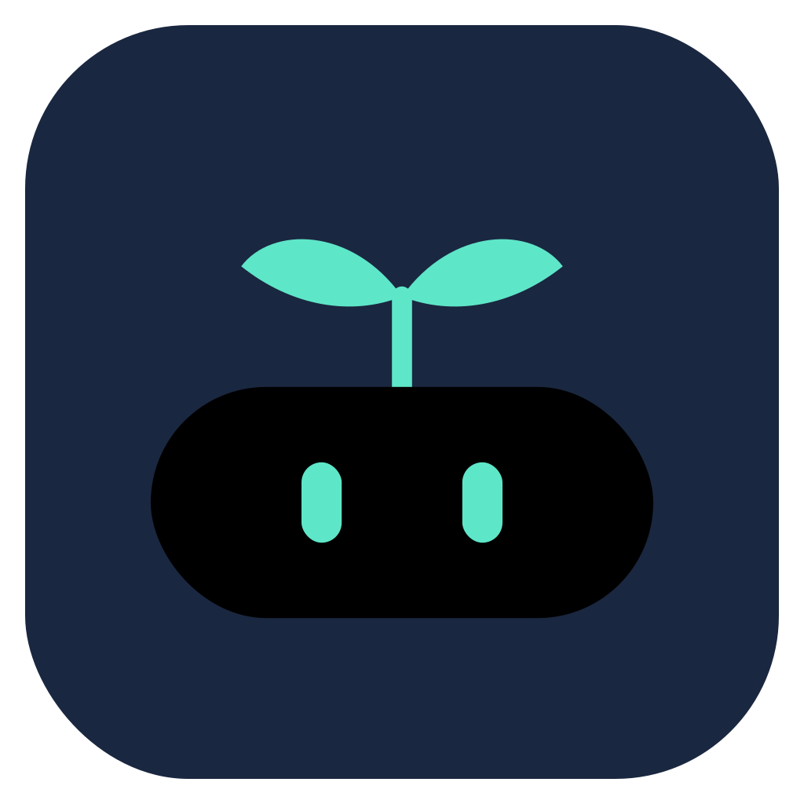

<div align="center">



# Islet

**羨慕 iPhone 的靈動島嗎？現在 Windows 也有了！**

音樂、社群通知、計時器、電腦效能，全部收進螢幕頂端的小膠囊。
不用切視窗，就能切歌、看訊息。


[功能](#-功能) · [安裝](#-安裝) · [怎麼用](#-怎麼用) · [技術](#️-用什麼做的) · [文件](docs/README.md)

</div>

> [!WARNING]
> 目前是 **測試版**，還沒有正式安裝檔，介面與設定之後都可能變動。

<!-- 之後放上截圖或 GIF：docs/images/preview.gif -->

## ✨ 這是什麼？

Islet 是一款給 Windows 10／11 用的「靈動島」。

平常它只是螢幕頂端的一顆小黑膠囊，顯示時間或正在播放的歌。換歌、收到訊息、計時結束時，它會彈一下告訴你。把滑鼠移上去，它就展開成完整的面板，用完會自己縮回去。

它不會擋到你：收合時點擊會直接穿透到下面的視窗，勿擾模式下也不會跳出提示。

## 🎯 功能

- 🏠 **首頁**：放你喜歡的圖片、純色，或目前播放歌曲的封面。
- 🎵 **音樂**：顯示歌名、封面和進度，可以播放、暫停、切歌、拖曳進度。支援 Spotify 和瀏覽器裡的 YouTube／YouTube Music。
- 💬 **社群通知**：只顯示 LINE、Discord、Messenger、Telegram 等聊天 App，以及 IG、FB 網頁版的通知，廣告和其他雜訊會被濾掉。點一下就打開原本的 App。
- ⏱️ **計時器**：倒數和碼錶，時間到會在島上提醒。
- 📊 **效能**：用圓環顯示 CPU、記憶體、GPU、磁碟的使用量，還有網路速度。
- ✅ **待辦**：隨手記下要做的事（存檔功能開發中）。
- ⚙️ **設定**：開機自動啟動、展開速度、分頁要顯示哪些、排列順序。

各功能目前的完成度請看[專案進度](docs/roadmap.md)。

## 📥 安裝

**需求**：Windows 10 版本 2004（組建 19041）以上，或 Windows 11（x64）。

正式安裝檔還沒有發佈。發佈後到 [Releases](https://github.com/shubingx/Islet/releases/latest) 下載 `Islet-Setup-x.y.z.exe`，雙擊安裝即可，不需要另外裝 .NET。

目前想試用的話，請照[開發指南](docs/development.md#從原始碼執行)從原始碼執行：

```powershell
git clone https://github.com/shubingx/Islet.git
cd Islet
dotnet run
```

## 🖱️ 怎麼用

| 動作 | 效果 |
| --- | --- |
| 滑鼠停在膠囊上 | 展開面板 |
| 滑鼠移開 | 自動收合 |
| 滾輪或下方圓點 | 切換分頁 |
| 齒輪按鈕 | 開啟設定 |
| 展開後按右鍵 | 勿擾、固定展開、模式、結束 |

第一次使用通知功能時，Windows 會詢問是否允許 Islet 讀取通知，按「允許」即可。所有通知內容都只在你的電腦上處理，不會上傳。

完整的操作方式和常見問題請看[使用說明](docs/user-guide.md)。

## 🛠️ 用什麼做的

- **C# + .NET 10**：主程式
- **WPF**：透明、置頂的膠囊視窗和彈簧動畫
- **Windows 內建 API**：讀取播放中的媒體（SMTC）、讀取系統通知、讀取效能計數器（PDH）

技術細節和專案架構請看[開發指南](docs/development.md)。

## 📚 文件

所有詳細文件都在 [`docs/`](docs/README.md)：使用說明、開發指南、專案進度、設計文檔、打包發佈、參與貢獻、授權與開源規範。

## 📜 授權

本專案以 [MIT 授權](LICENSE) 釋出，© shubingx。

「Dynamic Island／動態島」是 Apple 的產品名稱，Spotify、YouTube、LINE、Discord、Instagram 等名稱與商標屬於各自的擁有者，本專案與這些公司都沒有關係。

---

<div align="center">

如果你喜歡這個專案，給個 ⭐ 就是最大的鼓勵！

</div>
